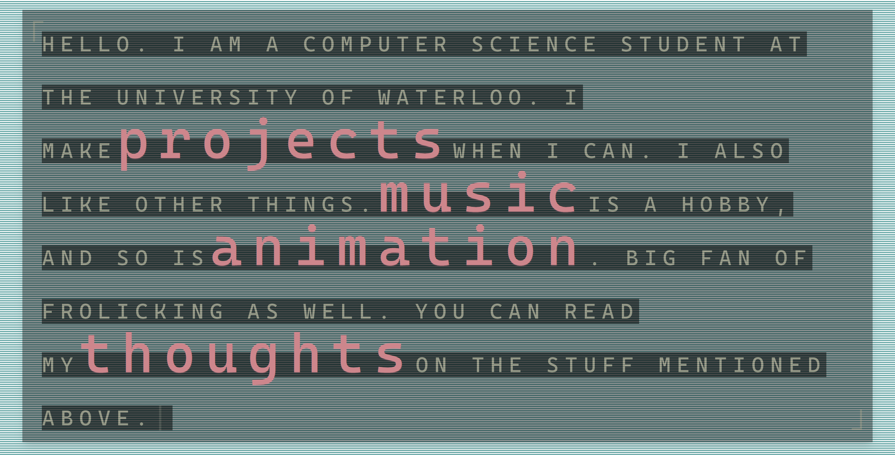

# personal site

deployed by vercel at https://bad-luck-to-talk.vercel.app

- react 19 + next.js 16 (app router)
- node 20.9+
- tailwind
- typescript

## wip
### index
- page is a server-rendered shell around a client-side typewriter component
- navigation links are embedded in the typed text and revealed as the animation
progresses
### projects - 80%
- client-rendered css grid of project links with custom hover and
cursor interactions
- gsap handles the project entrance and magnetic hover animations
### music - 80%
- server fetches youtube thumbnails and converts them into ascii before
passing the resolved track list to the player
- client-side youtube player manages playback, transitions, and direct song
selection
### animation - 0%
### thoughts - 80%
- posts are stored in a neon postgres database and managed through a
github oauth authenticated admin area
- drizzle manages the database schema

